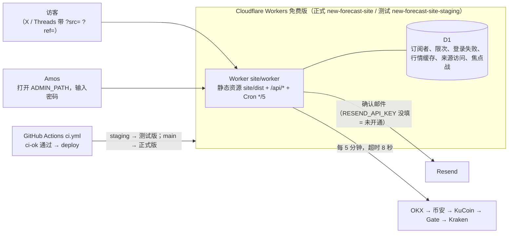

# 项目地图：new-forecast（Quick Come）
- 用途：**新加入的人或大模型先读这一份**，10 分钟了解项目现在是什么样、代码在哪里、有哪些不能破坏的约定。要查具体的文件、接口、表、变量、历史问题，看《[项目索引](项目索引.md)》。
- 只写**当前状态**。技术方案、需求单是当时的记录；和本文件不一致时，以本文件和代码为准。
- 版本：v1.1（2026-10-29，对应代码：`site/` 官网 / 等候页 / 名单页 v1.1，开发分支 `claude/site-v1.1`）
- 维护：研发整合，各角色写自己的部分（C53）。**每次功能迭代，在同一个 PR 里更新本文件和《项目索引》**；`scripts/check-project-index.mjs` 在 CI 里检查索引（C54）。
- **内部文档**：需求单、技术方案、调研、《Amos 待办》在私有仓库 `dollar3651314/agents` 的 `产品/forecast/`（agents 规则 C119），本仓库只放代码和这两份地图、索引；文档清单见《项目索引》第 9 节。
- 变更历史：v1.0（2026-10-29）首次创建；v1.1（2026-10-29）Amos 测试版验收的 13 个问题：专属页面合并确认和邀请、HTML 邮件、通用登录失败提示、来源名字和邀请人、焦点战下拉 / 选择器 / Excel 导入、导出 Excel、去掉测试版整站密码门、名单页地址改成密钥 ADMIN_PATH

## 一图看懂
这张图想说明：一个 Cloudflare Worker 同时提供页面、接口和每 5 分钟的定时任务，数据存在 D1，发信用 Resend；名单页在一个不公开的地址（密钥 ADMIN_PATH）下，用一个密码登录；官网公开页面不要密码（测试版只是不让搜索引擎收录）。



## 1. 这个项目做什么
Quick Come（预测产品）的代码仓库。现在只有官网 / 等候页（阶段 C：品牌·官网·预热），交易系统以后按阶段 D 的技术方案加目录。

| 业务 | 版本 | 使用者 | 页面 | 接口 | 数据 |
|---|---|---|---|---|---|
| 首页（M-1 返奖率、M-2 焦点战 + BTC 每小时场、M-3 怎么玩、M-4 BEP20、M-6 内测勾选、M-7 社媒、M-8 常见问题、M-11 分享卡片、M-12 备用网址） | v1 | 访客 | `/` | `/api/public/board`、`/api/public/matches`、`/api/public/site`、`/api/public/visit` | `board_cache`、`featured_matches`、`visit_daily` |
| 留邮箱、确认、退订 | v1.1 | 访客 | `/`、`/subscription?k=`（专属页面）、`/unsubscribe` | `/api/public/subscribe`、`/api/public/subscription`（含 `/resend`、`/unsubscribe`、`/resubscribe`）、`/api/public/unsubscribe`；旧链接 `/api/public/confirm` | `subscribers`、`rate_limit` |
| 邀请（M-10） | v1.1 | 订阅者 | `/subscription?k=`（旧 `/invite?k=` 跳过来） | `/api/public/subscription` | `subscribers.invite_code`、`invite_key` |
| 法律页 | v1 | 访客 | `/about/terms`、`/about/privacy`、`/about/risk` | — | — |
| 名单页（M-9 指标、邀请排行、名单、M-2 焦点战编辑和导入、导出 Excel） | v1.1 | Amos | 密钥 `ADMIN_PATH` 的地址 | `<ADMIN_PATH>/api/*` | 全部表；`auth_fail`、`auth_lock` |

最核心的流程：访客留邮箱 → 页面显示"✓ 確認信已寄出" → 收到 HTML 确认信，点"確認訂閱"按钮 → **打开的就是本人的专属页面，页面脚本自动确认，不用再按按钮**（之后任何时候打开、刷新都是这一页：订阅成功、充值提醒、邀请链接、已邀请人数、取消订阅）→ 朋友 `?ref=码` 留邮箱并确认算一次邀请 → Amos 在名单页看"访问 → 确认"转化和邀请排行 → 开放交易时导出 Excel 导入交易系统。

需求和关卡结论：agents `产品/forecast/市场/v1-营销系统需求单.md` v1.2（M-5 入金教程不做；M-4 只讲 BEP20、不点名交易所；M-10 现在做；M-2 名单页手动填）；技术方案 agents `产品/forecast/架构方案/v1-官网技术方案.md`。

## 2. 代码怎么分层
```
site/
  wrangler.toml            Worker 配置：正式版（顶层）+ [env.staging]；密钥和 D1 编号不在这里
  worker/src/              Worker（TypeScript）：index.ts 入口 → app.ts 路由 → 各功能模块
  worker/content/          邮件的文字（JSON，C6）
  web/                     页面（Vite + React）：index.html 公开页面、console.html 名单页（两个入口；公开页面的代码里没有名单页的接口和入口）
  web/src/i18n/            三语文案 zh-TW（默认）/ zh-CN / en
  shared/rules.ts          前后端共用的规则（邮箱、语言、来源参数、邀请码、焦点战时间、算例；C108）
  migrations/              D1 表结构（只往前走）
  test/                    vitest：worker/（接口，Miniflare 本地 D1）、web/（jsdom 组件）、shared/（规则、脚本）
  scripts/                 构建产物检查、本机端到端、D1 一键准备、部署、分享卡片 PNG
scripts/check-project-index.mjs   索引检查（从 agents/工具 原样复制，不在这里改）
assets/v1/site/            端到端截图
```
- 正式版除 `/assets/*`（带哈希的 JS、CSS）以外都先进 Worker（`run_worker_first = ["/*", "!/assets/*"]`）：名单页的地址是密钥，只有 Worker 知道，`/console.html` 也要由 Worker 挡住；代价是每次打开页面多算一次 Worker 请求（免费版每天 10 万次）。找不到的地址回 `index.html`，由 `web/src/App.tsx` 按地址选页面。测试版 `run_worker_first = true`，每个回答加 `X-Robots-Tag: noindex`，`/robots.txt` 禁止整站收录；**公开页面不要密码**。
- 页面之间用普通链接跳转（每页完整加载），没有前端路由库。
- **参照了旧仓库 forecast（main `0caa740`，只参照不照搬，C124）**：`cf/src/`（`http.ts`、`util.ts`、`ratelimit.ts`、`waitlist.ts`、`mail.ts`、`mailTexts.ts`、`board.ts`、`health.ts`、`admin.ts`、`attribution.ts`、`visit.ts`）→ 本仓库 `site/worker/src/` 对应模块；`cf/migrations/0001_init.sql`；`cf/scripts/ensure-d1.mjs`、`deploy.sh`、`check-dist.mjs`、`e2e-local.sh`；`cf/test/helpers.ts`；`cf/wrangler.toml`；`web/site/src/content/legal.ts`（改写成上线前网站的版本）；`web/client/src/lib/emailRule.ts`；`web/client/src/app/PrelaunchApp.tsx`（等候页结构）；S18 的台湾用语处理（`开发记录/S18-台湾预热.md` 第 3 节，改成测试里的用语黑名单）；`开发记录/S19-公开部分上Cloudflare.md`、`部署方案/v1-公开部分Cloudflare操作清单.md`。和 S19 的差别：名单页从 Cloudflare Access 改成一个不公开的地址 + 一个密码；新增焦点战、内测、邀请、验证指标、备用网址；页面新写（不复用交易客户端）。

## 3. 环境
| 环境 | 分支 | 地址 | 数据 | 外部服务 |
|---|---|---|---|---|
| 本机 | 任意 | `http://localhost:8799`（`npm run dev` 或 `scripts/e2e-local.mjs`） | wrangler 本地 D1 | Resend 替身或未开通；行情真实网络 |
| 单元测试 / CI | PR | — | Miniflare 本地 SQLite（每个测试文件一个新库） | 全部替身 |
| 测试环境 | `staging` | `https://fc-test-www.quickcome.online`（Amos 2026-10-29 指定，在控制台绑自定义域名）；部署后也能用 `https://new-forecast-site-staging.jeff-zhaifei.workers.dev` | D1 `new-forecast-site-staging` | 和正式版分开的密钥 |
| 生产 | `main` | `https://www.quickcome.online`（Amos 验收后在控制台绑）；备用 `https://new-forecast-site.<账户子域名>.workers.dev`（M-12） | D1 `new-forecast-site` | Resend、OKX、币安、KuCoin、Gate、Kraken |

- **发布**：开发分支 → PR 到 `staging`（部署测试版）→ Amos 在测试版验收（C34）→ `staging → main` 的 PR，Amos 同意后合并（部署正式版）。官网一部署就对外（正式版开着 `workers.dev` 备用地址），所以从第一天起按 C97 的"上线后"流程走，不用"上线前开发 PR 直接进 main"。GitHub Actions `ci.yml`：push 到 `staging` / `main` 跑完整检查，`ci-ok` 和 `site` 通过后 `deploy` job 运行 `site/scripts/deploy.sh`（D1 没有就建 → 迁移 → 部署 → 取 workers.dev 地址作为 `BACKUP_URL` 再部署一次 → 打印健康检查摘要）。
- **仓库**：公开（C96）；分支保护把 `ci-ok` 设为必须通过并勾选"不允许绕过"；打开"自动删除已合并的分支"（C95）——由运维分步指导 Amos 设置。
- **Amos 要填的**（只填名字对应的值，值不经过 AI，C21）：
  - GitHub → Settings → Secrets and variables → Actions：Secret `CLOUDFLARE_API_TOKEN`（自定义令牌：Account 级 Workers Scripts Edit、D1 Edit、Account Settings Read，只授权这个账户）、Secret `CLOUDFLARE_ACCOUNT_ID`；可选 Variable `SITE_BACKUP_URL`（不填时部署脚本自动取）。
  - Cloudflare 控制台 → Workers & Pages → 各 Worker → Settings → Variables and Secrets（测试版、正式版各填一次，类型选 Secret）：`ADMIN_PATH`（v1.1 新增：名单页的地址，开头的 / 可以不写（自动补上），/ 后面至少 6 个字符、只有字母数字和 -（Amos 2026-10-29 从 11 个放宽到 6 个）；测试版、正式版用不同的值）、`ADMIN_PASSWORD`（≥ 16 个字符）、`RESEND_API_KEY`。
  - 第一次部署前在 Workers & Pages 设好 workers.dev 子域名（账户只需一次）。
- **默认关着的功能（C102）**：
  | 功能 | 为什么默认关 | 怎么打开 | 打开后看到 |
  |---|---|---|---|
  | 发确认邮件 | 密钥要 Amos 填 | 填 Secret `RESEND_API_KEY` | `/api/health` 的 `checks.mail` = `ok` |
  | 名单页 | 没有地址和密码时不能有入口 | 填 Secret `ADMIN_PATH` 和 `ADMIN_PASSWORD` | 打开 `<ADMIN_PATH>` 出现密码框；`checks.admin` = `ok` |
  | 自定义域名 | 验收前不对外 | Amos 在控制台给正式 Worker 绑 `www.quickcome.online` | 正式域名打开首页 |

## 4. 关键流程在哪里
| 流程 | 入口 | 核心代码 |
|---|---|---|
| 留邮箱（限次、陷阱字段、重发规则、不透露是否已在名单） | `web/src/components/SubscribeForm.tsx` | `worker/src/subscribe.ts` `subscribe` |
| 专属页面（打开就确认、邀请、退订、过期重寄） | `web/src/pages/Subscription.tsx`（旧链接 `Confirm.tsx`、`App.tsx` `LegacyInvite`） | `subscribe.ts` `subscription*`、`confirm`、`channelOf` |
| 发确认邮件（纯文本 + HTML 按钮） | — | `worker/src/mail.ts` `confirmMail`、`worker/content/mail.json` |
| 看板定时任务 | `worker/src/index.ts` `scheduled` | `worker/src/board.ts` `refresh` |
| 名单页地址、登录、会话、锁定 | `web/src/admin/AdminApp.tsx` `Login` | `worker/src/app.ts` `adminRoute`、`auth.ts` `adminPath`、`admin.ts` `login` `authFailed` |
| 指标、邀请排行、名单、导出 Excel | `AdminApp.tsx`、`admin/xlsx.ts` `downloadExport` | `admin.ts` `metrics`、`subscribers`、`exportJson` |
| 焦点战增删改、批量导入和首页显示 | `AdminApp.tsx` `MatchesEditor` `MatchImport`、`admin/xlsx.ts`、`components/Sections.tsx` `Matches` | `worker/src/matches.ts`、`shared/rules.ts` `validateMatch` `pickMatches` |
| 部署 | `.github/workflows/ci.yml` `deploy` | `site/scripts/deploy.sh`、`ensure-d1.mjs` |

## 5. 不能破坏的约定
1. **页面上没有注册、登录、充值、下注、提现入口**，`/api/` 下没列出的一律 404；`scripts/check-dist.mjs` 拦住交易类路径和接口，公开页面的 JS 里不能有 `/api/admin`（需求单第三节底线）。
2. **名单页的地址是密钥 `ADMIN_PATH`，不写在代码、配置和构建产物里**（仓库公开）；`ADMIN_PATH` 不合规或 `ADMIN_PASSWORD` 少于 16 个字符 / 没填时，名单页整体不存在（默认关着，C102）。`/admin`、`/admin.html`、`/console.html`、`/api/admin/*` 永远和不存在的地址一模一样，不暴露"这里有后台"。**官网公开页面在测试版、正式版都不要密码**。
3. 会话签名密钥由密码派生（`auth.ts` `hmacKey`），**改密码让旧会话全部失效**；名单页 Cookie 只在 `ADMIN_PATH` 下，HttpOnly、Secure、SameSite=Strict、12 小时。
4. 锁定：同一 IP 15 分钟错 5 次锁 15 分钟；全站 1 小时错 20 次锁 1 小时；锁着时连正确密码也不核对；导出时再输的密码同样计入。**对外的回答一律"登录失败，请稍后再试"（401 `AUTH_FAILED`），不说错了几次、锁多久、是不是被锁**；规则只写日志（`auth.failed`、`auth.locked`、`auth.rejected_locked`），日志只记 IP 和时间，**不记输入的内容**。
5. 留邮箱的回答永远是 `{"status":"check_email"}`（**不透露邮箱是否已在名单**）；确认邮件里**只有一个链接：专属页面**（退订放在邮件头 List-Unsubscribe 和专属页面上）；**确认只有 POST，由专属页面的脚本在打开时发**——GET 页面没有副作用，邮件扫描器预先打开链接不会替人确认；确认链接 7 天（恰好 7 天那一毫秒仍有效，过期后在专属页面重寄）、重发间隔 10 分钟（满 10 分钟那一毫秒可以发）、最多 5 封（过期重寄时重新算）、IP 每小时 10 次（C106）。
6. 邀请码（公开在 `?ref=`）和专属页面的私密密钥 `invite_key`（只在确认邮件里）不同；一次邀请 = `channel = 'invite'` 且确认过的订阅者。邀请码在留邮箱时就生成，确认后才显示给本人。
7. 名单页里邮箱（含邀请人）一律打码；完整邮箱只有"导出"一个出口：Worker 返回数据（`qc-waitlist-v2`，字段见 `worker/src/admin.ts` `EXPORT_FORMAT` 的注释），**Excel 在名单页浏览器里生成**（Worker 免费版每次请求 10ms CPU），中文表头和中文值（`web/src/admin/xlsx.ts`），只含已确认和已退订，导入时已退订的人不能再发营销邮件。页面、邮件、导出里**不出现内部编号（M-x、C-x）和英文技术词**，来源用 `shared/rules.ts` `channelLabel` 显示名字（测试检查）。
8. 前后端对同一个输入用同一套规则：`site/shared/rules.ts`（邮箱、来源参数、邀请码、焦点战字段和时间、导入挑场次）；焦点战时间按**台湾时间**（UTC+8）填（日期时间选择器、Excel 里的文字或日期数字都按台湾时间），库里存 UTC；名单页最多存 10 场、首页显示开赛时间最近的 6 场（`MATCH_LIMITS.max` / `shown`，2026-10-29 F-1，原 5 场），导入超过时只留开赛时间最近的 10 场；"今天新增"按台湾时间算（C108）。
9. 外部调用都有超时（C81）：行情每个源 8 秒、不重试（5 分钟后下次）；Resend 10 秒、5xx/429/网络错误隔 1 秒再试一次。`RESEND_API_URL`（替身地址）只在 `ENVIRONMENT` = `local` / `test` 时生效。
10. 用户能看到的文字放在 `web/src/i18n/*.json`、`web/src/content/legal.ts`、`worker/content/*.json`、`web/src/admin/texts.json`（C6）；三语键必须一致，繁中用台湾用语（`test/web/i18n.test.ts` 检查）；M-4 不点名任何交易所；不写稳赚、翻倍这类词。
11. 健康检查 `/api/health` 不返回任何密钥的值（包括名单页地址）；`admin` 在 `ADMIN_PATH`、`ADMIN_PASSWORD` 任一没配好时是 `not_configured`。
12. D1 迁移只往前走（Cloudflare 规范 K4），改表另加 `0002_…`，并兼容上一版代码。
13. 配色只有一种主题：深蓝 `#0F1B33`、青绿 `#2DD4BF`、琥珀 `#FBBF24`；涨跌不用红绿（台湾红涨绿跌）。不加载第三方字体和统计代码（隐私政策第 3 节）。

## 6. 常用命令
| 做什么 | 命令 |
|---|---|
| 安装 | `cd site && npm ci` |
| 类型检查 | `cd site && npm run typecheck` |
| 单元和接口测试 | `cd site && npm test` |
| 构建 + 产物检查 | `cd site && npm run build && npm run check-dist` |
| 配置能打包 | `cd site && npm run dry-run` |
| 项目地图和索引检查 | `node scripts/check-project-index.mjs` |
| 端到端（含截图） | `cd site && npm run build && node scripts/e2e-local.mjs`（不截图加 `--no-screenshots`） |
| 本地运行 | `cd site && npm run build && npx wrangler d1 migrations apply new-forecast-site --local --env= && npm run dev`（名单页要 `--var ADMIN_PATH:… --var ADMIN_PASSWORD:…` 或 `.dev.vars`，不进仓库） |
| 重新生成分享卡片 PNG | `cd site && node scripts/render-og.mjs` |
| 看线上状态 | 打开 `<地址>/api/health` |

## 7. 排查从哪里开始
1. `/api/health`：`checks.db`、`board`（每个行情源最近一次的结果）、`mail`、`admin`。
2. 《项目索引》第 8 节问题索引。
3. 日志：Cloudflare 控制台 → Workers → Logs（`[observability] enabled`），事件名 `mail.*`、`board.*`、`auth.*`、`admin.*`、`api.error`；邮箱打码。只有 Amos 能看。
4. 本机复现：`node site/scripts/e2e-local.mjs`。

## 8. 常见改动的检查清单
| 改动 | 要改的地方 |
|---|---|
| 新增接口 | `worker/src/app.ts`（或 `admin.ts`）→ 测试 `test/worker/` → 《项目索引》第 2 节；公开页面要用的加进 `scripts/check-dist.mjs` 的 `PUBLIC_APIS` |
| 新增环境变量 / 密钥 | `worker/src/env.ts` → `wrangler.toml`（普通变量，两个环境都写）或《项目地图》第 3 节（密钥）→ 《项目索引》第 5 节 → 健康检查（可选功能显示 `not_configured`） |
| 新增表或列 | 新迁移 `migrations/0002_….sql`（不改 0001）→ 《项目索引》第 4.1 节 → 导出格式要不要加字段 |
| 新增页面文案 | 三个 `web/src/i18n/*.json` 一起加（键一致），繁中用台湾用语 |
| 新增页面 | `web/src/App.tsx` `route` → `web/src/pages/` → 手机和电脑分开排版（C64）→ `public/robots.txt`、`sitemap.xml` → 端到端截图 |
| 改焦点战 / 邮箱规则 | 只改 `shared/rules.ts`，前后端同时生效；补 `test/shared/rules.test.ts` 的向量 |

## 9. 冷启动问题清单
1. 访客说收不到确认邮件，从哪里开始查？
2. 名单页打开是 404，可能是什么原因？
3. 首页焦点战要加一个"英文对战名"字段，要改哪些文件？
4. 测试环境连的是哪个 D1，定时任务是谁调用的，多久一次？
5. 一个 PR 合并前要通过哪些自动检查？没通过时去哪里看原因？
6. 开放交易时怎么把名单导进交易系统，文件里有哪些字段？

## 10. 已知限制和遗留
- 焦点战的联赛、对战名只有一种语言（Amos 填什么显示什么），英文页面也显示繁中的对战名。
- Cloudflare 上的实际部署、Resend 实际发信、Cloudflare 出口能否访问 OKX / 币安、`run_worker_first` 的 `/admin*` 写法在线上的行为：**未验证**（本机 wrangler dev 已通过）。部署后看 `/api/health`。
- 冷启动检查还没做（首次合并到测试环境前补，C53）。
- 名单页的 `ADMIN_PATH` 只在本机 wrangler dev 验证过；线上 `run_worker_first` 的排除写法（`!/assets/*`）在 Cloudflare 上的行为**未验证**（dry-run 通过），部署后打开 `/console.html`、`/admin` 应该是"找不到这个页面"。
- Resend 实际发出的 HTML 邮件在 Gmail / Outlook / 手机邮件 App 里的显示**未验证**（只在浏览器里渲染截图）。
- 名单页的文字是简体中文，导出的 Excel 表头和内容是繁体（和对外用语一致）。
- 访问计数按 IP 每小时 30 次限次，用于转化率的分母，不是精确的访客数。
